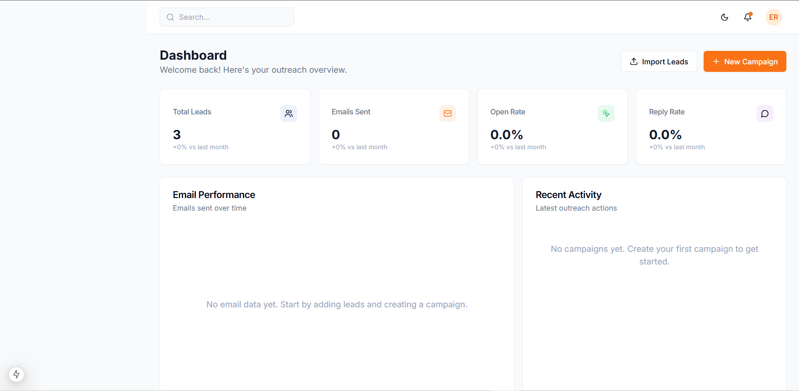

# ExportReach Pro

**AI-powered cold email outreach platform built for exporters.**

ExportReach Pro helps exporters reach importers worldwide: import your buyer list from
Excel, let AI write a personalised email for every contact, send it as a tracked
campaign, and automatically follow up until they reply — all scheduled around the
buyer's own timezone.



---

## Table of contents

- [Features](#features)
- [Tech stack](#tech-stack)
- [How it works](#how-it-works)
- [Setup guide](#setup-guide)
  - [0. Prerequisites](#0-prerequisites)
  - [1. Clone and install](#1-clone-and-install)
  - [2. Create the InsForge backend](#2-create-the-insforge-backend)
  - [3. Create the database schema](#3-create-the-database-schema)
  - [4. Get an AI API key](#4-get-an-ai-api-key)
  - [5. Configure environment variables](#5-configure-environment-variables)
  - [6. Run locally](#6-run-locally)
  - [7. Create your first user](#7-create-your-first-user)
  - [8. Deploy to Vercel](#8-deploy-to-vercel)
  - [9. Set up the automation (cron schedules)](#9-set-up-the-automation-cron-schedules)
  - [10. Configure email sending (SMTP)](#10-configure-email-sending-smtp)
- [Environment variables reference](#environment-variables-reference)
- [Sending limits — read this](#sending-limits--read-this)
- [Project structure](#project-structure)
- [Troubleshooting](#troubleshooting)
- [Security notes](#security-notes)

---

## Features

### Leads
- **Excel / CSV import** with a column-mapping step — map your sheet's headers to
  lead fields, no fixed template required.
- **Batched import** (50 rows at a time) with a live progress bar, so large files
  don't time out. Duplicate emails are skipped automatically (case-insensitive).
- **Custom lead fields** — define your own fields (Admin → Lead Fields); anything
  that isn't a built-in column is stored as JSON and usable in templates.
- Filter by country, status, and free-text search.

### AI email generation
- Generates a **personalised subject + body per lead** using the lead's company,
  contact, country, product interest and any custom fields.
- Choose your provider: **Google Gemini** or any **OpenAI-compatible** endpoint
  (OpenRouter incl. free models, NVIDIA, OpenAI, or a local model).
- Reusable **templates** with `{{placeholders}}` — use AI, or skip it entirely.

### Campaigns
- Assign leads, pick a template, set a **daily limit**, and send.
- **Scheduled start** — start a campaign automatically on a chosen **date, hour and
  timezone**, or leave it off and start manually.
- **Auto follow-ups** — automatically follow up after N days if there's no reply,
  sent at an hour you choose **in the buyer's timezone** so it lands in business hours.
- **Manage Leads** panel with Active / Replied tabs, bulk select, and bulk actions.

### Tracking
- **Open tracking** via a 1×1 pixel, **click tracking** via link rewriting.
- **Reply detection over IMAP** — polls your inbox hourly, matches replies to sent
  emails, and automatically stops follow-ups for anyone who replied.
- Analytics dashboard: sent / open rate / click rate / reply rate.

### Platform
- Multi-tenant: every user's data is isolated behind a custom JWT session.
- Secrets (SMTP password, AI keys) are **encrypted at rest** (AES-256-GCM).
- Health endpoint (`/api/health`) that validates config and database connectivity.

---

## Tech stack

| Layer | Technology |
|---|---|
| Framework | Next.js 15 (App Router) + React + TypeScript |
| Styling | Tailwind CSS + shadcn/ui + Radix |
| Backend / DB | [InsForge](https://insforge.dev) (managed Postgres + REST) |
| Auth | Custom JWT session (`jose`), httpOnly cookie, bcrypt |
| AI | Google Gemini, or any OpenAI-compatible API |
| Email | Nodemailer (SMTP) or Resend; IMAP (`imapflow`) for reply detection |
| Scheduling | InsForge Schedules (cron) → `/api/cron/*` |
| Hosting | Vercel (or self-host via the included Dockerfile) |

---

## How it works

```
┌──────────────┐   sends/reads    ┌────────────────┐
│  Next.js app │ ───────────────► │    InsForge    │
│  (Vercel)    │                  │  Postgres + API│
└──────┬───────┘                  └────────┬───────┘
       │                                   │
       │ SMTP / Resend                     │ Schedules (cron, hourly)
       ▼                                   │
┌──────────────┐                           │
│   Buyer's    │  opens/clicks             │
│   inbox      │ ──────────► /api/tracking │
└──────┬───────┘                           │
       │ replies                           ▼
       ▼                        ┌──────────────────────────┐
   Your inbox ◄──── IMAP poll ──│ /api/cron/poll-replies    │
                                │ /api/cron/followups       │
                                │ /api/cron/scheduled-starts│
                                └──────────────────────────┘
```

The app is the only thing that talks to InsForge (server-side, with an admin key).
InsForge's scheduler calls back into the app hourly to run follow-ups, poll for
replies, and start scheduled campaigns. Each cron endpoint authenticates itself
with a shared `CRON_SECRET`.

---

## Setup guide

> Estimated time: **20–30 minutes**. You need a free InsForge account, a free
> Vercel account, and a Gmail (or other SMTP) account.

### 0. Prerequisites

- **Node.js 20+** and npm — <https://nodejs.org>
- A **GitHub** account (to deploy from)
- A **[InsForge](https://insforge.dev)** account (free tier is fine)
- A **[Vercel](https://vercel.com)** account (free tier is fine)
- A **Gmail** account for sending (or any SMTP provider)

### 1. Clone and install

```bash
git clone <your-repo-url>
cd EmailSAAS
npm install
```

### 2. Create the InsForge backend

Log in and create a project:

```bash
npx @insforge/cli login
npx @insforge/cli create
```

Then link this folder to it (skip if `create` already linked it):

```bash
npx @insforge/cli link
```

Get your project's URL and API key:

```bash
npx @insforge/cli current
```

Copy the **OSS Host** (this is your `INSFORGE_URL`). Then get the project API key
from the InsForge dashboard under **API Keys** — it starts with `ik_`. This is
your `INSFORGE_API_KEY`.

> ⚠️ The `ik_` key is a **full-access admin key**. Keep it server-only. Never put
> it in a `NEXT_PUBLIC_*` variable.

### 3. Create the database schema

Run both migrations, in order:

```bash
npx @insforge/cli db migrations up --all
```

If that doesn't pick them up, apply them manually:

```bash
npx @insforge/cli db query "$(cat migrations/20260509085513_create-all-tables.sql)"
npx @insforge/cli db query "$(cat migrations/20260628000000_add-ai-provider-settings.sql)"
npx @insforge/cli db query "$(cat migrations/20260716000000_add-custom-fields-followups-and-scheduling.sql)"
```

Verify the tables exist:

```bash
npx @insforge/cli metadata
```

You should see: `campaigns`, `campaign_leads`, `emails`, `followups`, `leads`,
`lead_field_defs`, `templates`, `tracking_events`, `user_settings`, `users`.

### 4. Get an AI API key

Pick **one**:

- **Google Gemini (recommended, has a free tier)** — get a key at
  <https://aistudio.google.com/apikey>. It starts with `AIzaSy...`.
- **Any OpenAI-compatible provider** — e.g. [OpenRouter](https://openrouter.ai)
  (has free models), NVIDIA, or OpenAI. You'll enter the key, base URL and model
  in the app's Settings after first login.

### 5. Configure environment variables

```bash
cp .env.example .env.local
```

Fill it in:

```bash
NEXT_PUBLIC_APP_URL="http://localhost:3000"          # your real URL once deployed
INSFORGE_URL="https://YOUR-APPKEY.us-east.insforge.app"
INSFORGE_API_KEY="ik_your_project_key"
GEMINI_API_KEY="AIzaSy..."
AUTH_SECRET="<paste output of: openssl rand -hex 48>"
CRON_SECRET="<paste output of: openssl rand -hex 24>"
SECRETS_ENCRYPTION_KEY="<paste output of: openssl rand -hex 32>"
ALLOW_REGISTRATION="true"                             # set false after creating your user
```

Generate the secrets:

```bash
openssl rand -hex 48   # AUTH_SECRET
openssl rand -hex 24   # CRON_SECRET
openssl rand -hex 32   # SECRETS_ENCRYPTION_KEY
```

### 6. Run locally

```bash
npm run dev
```

Open <http://localhost:3000>. Check config health at
<http://localhost:3000/api/health> — you want:

```json
{ "status": "ok", "db": "ok", "missingEnv": [] }
```

### 7. Create your first user

Go to `/register` and sign up. **Then set `ALLOW_REGISTRATION="false"`** so nobody
else can register on your deployment.

### 8. Deploy to Vercel

```bash
npm i -g vercel
vercel login
vercel link          # create/select a project
```

Add **every** variable from step 5 to Vercel (Project → Settings → Environment
Variables), with two changes:

- `NEXT_PUBLIC_APP_URL` must be your **real production URL** (e.g.
  `https://your-app.vercel.app`) — the tracking pixel is built from it.
- Do **not** add `NEXT_PUBLIC_INSFORGE_ANON_KEY`. The admin key stays server-only.

Then deploy:

```bash
vercel deploy --prod
```

> ⚠️ **Turn OFF Vercel Deployment Protection / SSO** for this project
> (Settings → Deployment Protection). If it's on, Gmail can't reach your tracking
> pixel and **open tracking will silently never register**.

After deploying, update `NEXT_PUBLIC_APP_URL` to the production URL and redeploy
once, so the pixel URLs are baked in correctly.

### 9. Set up the automation (cron schedules)

Three background jobs power follow-ups, reply detection and scheduled starts.
First, store your `CRON_SECRET` in InsForge:

```bash
npx @insforge/cli secrets add CRON_SECRET "<the same value as your env var>"
```

Then create the three schedules (replace the URL with your production URL):

```bash
APP="https://your-app.vercel.app"

npx @insforge/cli schedules create \
  --name "ExportReach Follow-ups" --cron "0 * * * *" \
  --url "$APP/api/cron/followups" --method POST \
  --headers '{"x-cron-secret":"${{secrets.CRON_SECRET}}"}'

npx @insforge/cli schedules create \
  --name "ExportReach Reply Polling" --cron "0 * * * *" \
  --url "$APP/api/cron/poll-replies" --method POST \
  --headers '{"x-cron-secret":"${{secrets.CRON_SECRET}}"}'

npx @insforge/cli schedules create \
  --name "ExportReach Scheduled Starts" --cron "0 * * * *" \
  --url "$APP/api/cron/scheduled-starts" --method POST \
  --headers '{"x-cron-secret":"${{secrets.CRON_SECRET}}"}'
```

Verify:

```bash
npx @insforge/cli schedules list
```

Test one manually (should return `401` without the secret, `200` with it):

```bash
curl -i -X POST "$APP/api/cron/followups"                               # 401
curl -i -X POST -H "x-cron-secret: <secret>" "$APP/api/cron/followups"  # 200
```

> All three run **hourly**, so scheduled campaigns and follow-ups fire at the
> **top of the hour** you choose. Minutes are not used.

### 10. Configure email sending (SMTP)

In the app: **Settings → Integrations → SMTP Configuration**.

For **Gmail**:

| Field | Value |
|---|---|
| SMTP Host | `smtp.gmail.com` |
| Port | `465` |
| Username | your full Gmail address |
| Password | a Google **App Password** (not your normal password) |

To create an App Password:

1. Enable **2-Step Verification**: <https://myaccount.google.com/security>
2. Go to <https://myaccount.google.com/apppasswords>
3. Create one, and paste the 16-character code (without spaces).

Reply detection uses these same Gmail credentials over IMAP — no extra setup.

> **Alternative:** use [Resend](https://resend.com) instead — paste an API key
> under Settings → Resend API. Better deliverability at volume, but you must
> verify a sending domain.

---

## Environment variables reference

| Variable | Required | Description |
|---|---|---|
| `NEXT_PUBLIC_APP_URL` | ✅ | Public URL. Must be reachable by Gmail for open tracking. |
| `INSFORGE_URL` | ✅ | Your InsForge project URL. |
| `INSFORGE_API_KEY` | ✅ | InsForge `ik_` admin key. **Server-only.** |
| `AUTH_SECRET` | ✅ | Signs JWT sessions. `openssl rand -hex 48` |
| `CRON_SECRET` | ✅ | Protects `/api/cron/*`. Must match the InsForge secret. |
| `SECRETS_ENCRYPTION_KEY` | ➖ | Encrypts stored SMTP/AI keys. Derived from `AUTH_SECRET` if unset — set it explicitly in production. |
| `GEMINI_API_KEY` | ➖ | Gemini key. Optional if you configure a provider in Settings. |
| `ALLOW_REGISTRATION` | ➖ | `false` disables public signup. Recommended after setup. |
| `SMTP_*` / `RESEND_API_KEY` | ➖ | Fallbacks only; normally configured per-user in Settings. |

---

## Sending limits — read this

Free tiers have real caps. Plan around them:

- **Gmail: ~500 emails/day** per account. This is the binding limit for most users.
  For higher volume, use multiple sender accounts or switch to Resend with a
  verified domain.
- **Campaign daily limit** caps how many emails go out per campaign run (default 50,
  max 500). If more leads are pending, the rest wait for the next run.
- **Vercel / InsForge free tiers** have their own usage limits.

---

## Project structure

```
src/
  app/
    (dashboard)/       # Authenticated pages: dashboard, leads, campaigns,
                       # templates, emails, analytics, settings, admin
    api/
      auth/            # register, login, logout, me, change-password
      leads/           # CRUD, import (parse/analyze/batch), countries, sample
      campaigns/       # CRUD, [id]/start, [id]/leads, [id]/leads/status
      emails/          # send, generate, followup
      templates/       # CRUD + AI generation
      cron/            # followups, poll-replies, scheduled-starts (CRON_SECRET)
      tracking/[id]/   # open pixel   (public)
      click/           # click redirect (public)
      health/          # config + DB probe (public)
      admin/           # custom lead field definitions
  lib/
    insforge.ts        # InsForge client (server-only admin key)
    auth.ts            # JWT sessions
    crypto.ts          # AES-256-GCM at-rest secret encryption
    email.ts           # sending, tracking pixel, link rewriting
    imap.ts            # reply polling
    ai-gateway.ts      # Gemini / OpenAI-compatible routing
  middleware.ts        # auth gate + public route allowlist
migrations/            # SQL schema
```

---

## Troubleshooting

| Symptom | Fix |
|---|---|
| `/api/health` shows `db: "unreachable"` | `INSFORGE_API_KEY` is wrong or revoked. Generate a new `ik_` key and redeploy. |
| `/api/health` lists `missingEnv` | Add the named variables in Vercel, then redeploy. |
| Emails send but **opens never register** | Vercel Deployment Protection is ON, or `NEXT_PUBLIC_APP_URL` isn't your real public URL. Gmail must be able to fetch the pixel. |
| Campaign save fails | The catch-up migration hasn't run — see [step 3](#3-create-the-database-schema). |
| Cron returns `401` | `CRON_SECRET` in Vercel doesn't match the InsForge secret. |
| Follow-ups never send | Check the campaign's follow-up hour/timezone, and that the schedule is active (`schedules list`). Runs hourly, on the hour. |
| SMTP auth fails on Gmail | You used your login password. You need an **App Password** with 2FA enabled. |
| Replies not detected | IMAP reply detection is **Gmail-only** today, and uses the SMTP credentials you saved. |

---

## Security notes

- The InsForge `ik_` key is **full-access** and bypasses row-level security. It is
  read only from server-side env vars and never reaches the browser bundle. Don't
  move it to a `NEXT_PUBLIC_*` variable.
- SMTP passwords and AI keys are **encrypted at rest** before being stored.
- Set `ALLOW_REGISTRATION="false"` once your users exist.
- Rotate `AUTH_SECRET` to invalidate all sessions.
- Never commit `.env*`, `.insforge/project.json`, or `.vercel/` — all are gitignored.
- `scratch/` is gitignored because throwaway scripts there have historically held
  hardcoded keys.

---

## License

See [LICENSE](LICENSE).
